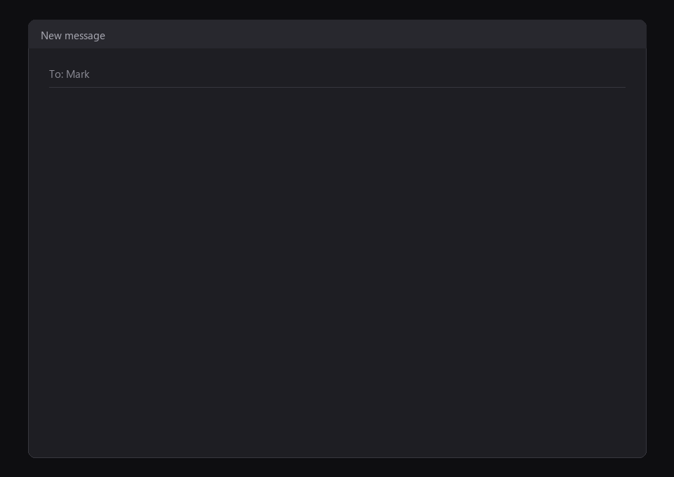
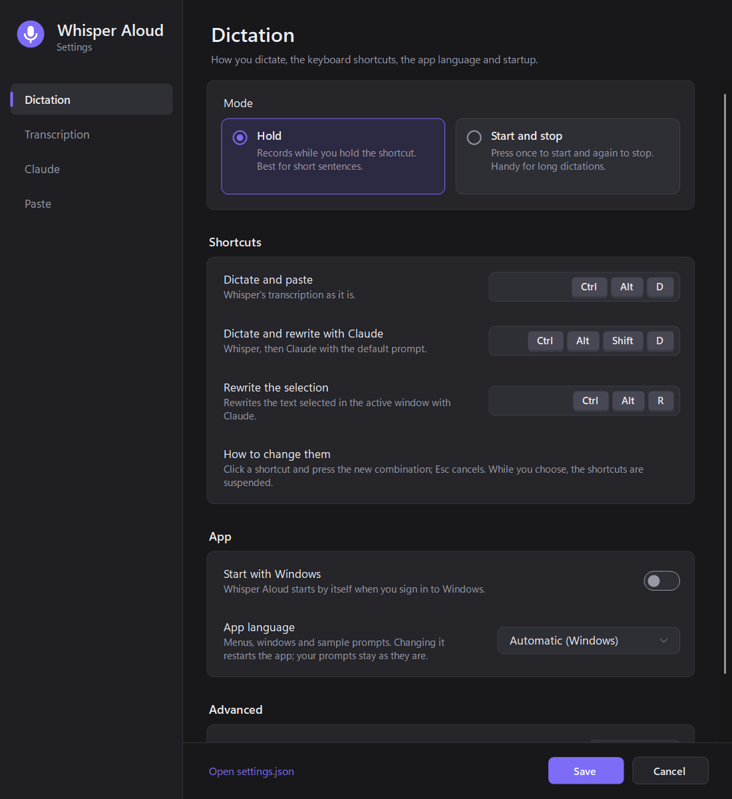

# Whisper Aloud

**Voice dictation for Windows, free, open source, unlimited.**\
Powered by whisper.cpp and your Claude Code CLI (optional).

Hold a shortcut, speak, release: the text appears in the active window.

- **Local transcription**
  - With [Whisper.net](https://github.com/sandrohanea/whisper.net) (whisper.cpp) and the quantized `large-v3-turbo` model, on the GPU through Vulkan.
- **Optional rewriting with Claude**
  - [Prompts](docs/settings.md#prompts): light proofreading, meeting notes, translation, or your own.
  - Through the [Claude Code](https://code.claude.com/docs/en/overview) CLI in headless mode, using the Claude subscription already signed in on the machine.

## Prerequisites

- Windows 10 or 11, x64.
- A GPU with a Vulkan driver for fast transcription. Without one Whisper falls back to the CPU and is much slower. On laptops with hybrid graphics the app picks the dedicated GPU automatically: see [latency](docs/latency.md#laptops-with-two-gpus).
- For rewriting only: [Claude Code](https://code.claude.com/docs/en/overview) installed and signed in (`claude` on the `PATH` or in `%USERPROFILE%\.local\bin`). The app never handles logins or credentials. Without Claude Code it simply transcribes, and you can turn Claude off in the settings.

## Usage

Download `WhisperAloud.exe` from the [latest release](https://github.com/mgiuseppe/whisper-aloud/releases/latest) and run it: no installation, and .NET is included. On first start the app downloads the Whisper model (~550 MB) to `%LOCALAPPDATA%\WhisperAloud\models` and creates `%APPDATA%\WhisperAloud\settings.json`. To have it start when you sign in, turn on **Start with Windows** in the settings.

The exe is not code-signed, so the first time Windows SmartScreen may say "Windows protected your PC": choose **More info**, then **Run anyway**.

To run it from the source code instead, see [Contributing](CONTRIBUTING.md#build-and-run).

### Shortcuts

| Shortcut | What it does |
|---|---|
| `Ctrl+Alt+D` (hold) | dictate and paste Whisper's transcription as it is |
| `Ctrl+Alt+Shift+D` (hold) | dictate, rewrite with the default Claude prompt, paste |
| `Ctrl+Alt+R` | rewrite the selected text with the default prompt and replace it |

> [!NOTE]
> Whisper transcribes in the language set in the settings (Italian or English by default, following the app language), not the one it hears. You can set it to `auto` to detect the language from the recording, handy if you switch languages often, but on short dictations it guesses wrong more often: see [Transcription settings](docs/settings.md#transcription).

## Settings

Double-click the tray icon, or choose **Settings...** from its menu. Four pages cover dictation mode and shortcuts, microphone and GPU, Claude and its prompts, and what happens after the transcription. Changes apply as soon as you press **Save**, without restarting the app.

Every option, the prompt editor and the `settings.json` reference are described in [docs/settings.md](docs/settings.md).

## Documentation

- [Settings](docs/settings.md): the settings window, prompts and `settings.json`.
- [How it works](docs/how-it-works.md): recording, transcription, rewriting with the Claude Code CLI and pasting.
- [Latency](docs/latency.md): measurements, model choice and the hybrid-graphics pitfall.
- [Contributing](CONTRIBUTING.md): project structure, build, tests and benchmark.

## Known limitations

- Push-to-talk detects the release by checking the key every 15 ms, because `RegisterHotKey` only reports the key press.
- Pasting goes through the clipboard: the previous contents are restored after 400 ms, but clipboard history managers still see the dictated text.
- The bundled audio samples use a synthetic voice: they measure timing well, not transcription quality on a real voice.
- After a rewrite a `claude` process stays ready for 5 minutes (about 180 MB of memory, no requests to the model until needed), then closes. The first rewrite after a pause starts it while you speak; **Rewrite the selection** after a pause takes a few seconds longer.
- Every rewritten dictation is a request to the model and counts towards the usage limits of your Claude subscription.

## Personal use and Anthropic's terms

Whisper Aloud is a personal project, not affiliated with or endorsed by Anthropic. For rewriting it runs the Claude Code CLI exactly as distributed, without modifying it: you sign in through Anthropic's own flow, and the app never reads, stores or transmits credentials or tokens. Anyone using it does so with their own Claude account, under [Anthropic's terms](https://code.claude.com/docs/en/legal-and-compliance) and the usage limits of their own subscription. To use it inside products or services offered to others, Anthropic requires API key authentication.

## License

[MIT](LICENSE).
