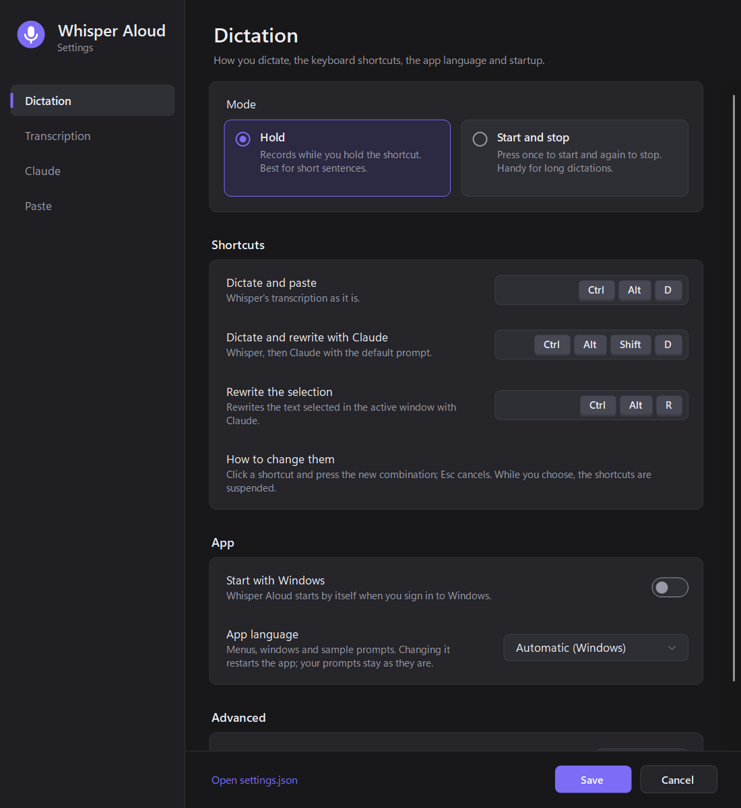
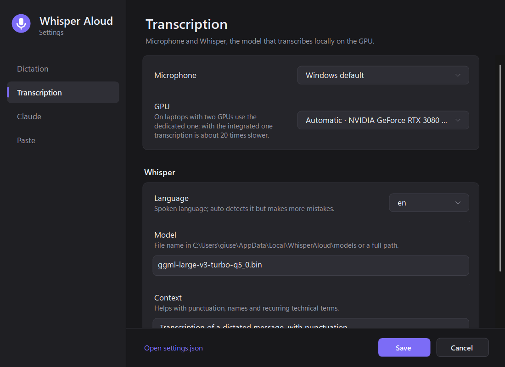
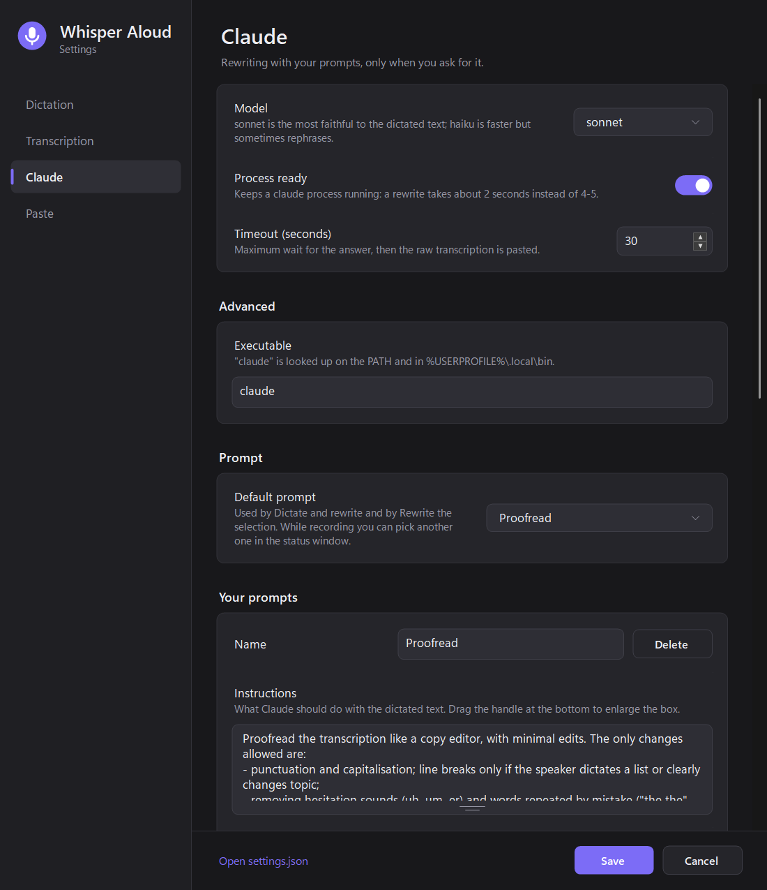
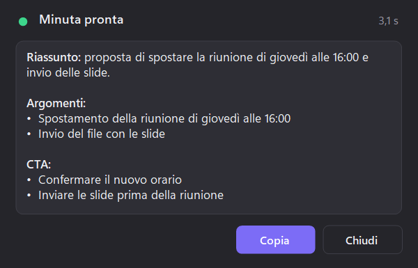
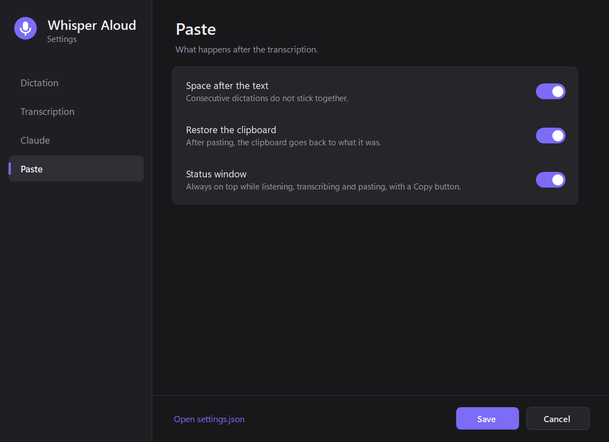
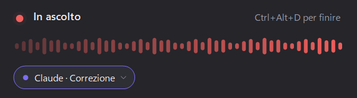
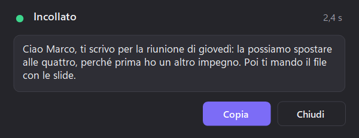

# Settings

Open the settings window by double-clicking the tray icon, or with **Impostazioni...** in the tray menu. Changes apply as soon as you press **Salva** (Save): the app reloads only what changed, for example Whisper when you pick another GPU or model, or the `claude` process when you change its options. **Annulla** (Cancel) discards them.

The interface is in Italian: below, each option is listed with its label as it appears in the app, followed by an explanation.

- [Dictation](#dictation)
- [Transcription](#transcription)
- [Claude](#claude)
- [Prompts](#prompts)
- [Paste and status window](#paste-and-status-window)
- [Tray menu](#tray-menu)
- [settings.json reference](#settingsjson-reference)
- [Files and folders](#files-and-folders)

## Dictation

- **Modalità** (mode):
  - **Tieni premuto** (hold): records while you hold the shortcut. Best for short sentences.
  - **Avvio e stop** (start and stop): press once to start and again to stop. Handy for long dictations.
- **Scorciatoie** (shortcuts): click a shortcut and press the new key combination; `Esc` cancels. While a shortcut field has the focus, the global shortcuts are suspended, so pressing the combination does not start a dictation. Without modifiers only function keys (`F1`–`F24`) are accepted.
  - **Detta e incolla**: dictate and paste Whisper's transcription as it is.
  - **Detta e riscrivi con Claude**: dictate, rewrite with the default prompt, paste.
  - **Riscrivi la selezione**: rewrite the text selected in the active window with the default prompt.
- If a shortcut is already taken by another app, Whisper Aloud says so and still registers the others.
- **Pressione minima** (minimum press, ms): hold mode only; shorter presses are treated as accidental and show a hint instead of recording.

## Transcription

- **Microfono** (microphone): the Windows default device or a specific one. It can also be chosen from the tray menu.
- **GPU**: **Automatica** picks the first dedicated GPU listed by Vulkan; otherwise choose a device. On laptops with two GPUs the integrated one is about 20 times slower: see [latency](latency.md#laptops-with-two-gpus).
- **Lingua** (language): the spoken language (`it`, `en`, `fr`, `de`, `es`, `pt`) or `auto`, which detects it but makes more mistakes.
- **Modello** (model): the file name inside the models folder, or a full path to another ggml model.
- **Contesto** (context): a sentence that tells Whisper what to expect. It helps with punctuation and with recurring names or technical terms. Drag the handle at the bottom to enlarge the box.

## Claude

- **Modello** (model): `sonnet` is the most faithful to the dictated text; `haiku` is faster but sometimes rephrases. See [latency](latency.md#rewriting).
- **Processo pronto** (process ready): keeps a `claude` process started in the background, so a rewrite takes about 2 seconds instead of 4–5. See [how it works](how-it-works.md#the-standby-process).
- **Timeout (secondi)**: how long to wait for Claude; after that the raw transcription is pasted.
- **Eseguibile** (executable): `claude` is looked up on the `PATH` and in `%USERPROFILE%\.local\bin`; use a full path for a different installation.
- **Prompt predefinito** (default prompt): used by **Detta e riscrivi con Claude** and **Riscrivi la selezione**.

## Prompts

A prompt tells Claude what to do with the dictated text. Each one has:

- **Nome** (name): shown in the status window and in the menus.
- **Istruzioni** (instructions): what Claude should do, in plain words. Drag the handle at the bottom of the box to enlarge it while you write; double-click the handle to switch between compact and large.
- **Incolla il risultato** (paste the result): when on, the result is pasted into the active window; when off, it stays in the status window until you close it, ready to copy. Useful for minutes and summaries.

**+ Aggiungi prompt** adds a new one and **Elimina** deletes it; at least one prompt must remain, and names must be unique.

Included prompts:

| Prompt | Instructions in short | Pastes |
|---|---|---|
| Correzione | light proofreading: punctuation, hesitations, words repeated by mistake, self-corrections ("at three, no, at four"); same words, same order, never changes the meaning | yes |
| Minuta | short summary, list of topics, one or more calls to action, very concise | no |
| Traduzione in inglese | translate the dictation into English | yes |
| Pirata ubriaco | rewrite it the way a drunk pirate would say it | yes |

Claude may answer in Markdown: the status window shows headings, **bold** and bullet lists formatted, while **Copia** (Copy) and pasting use the original Markdown.

The default prompt is chosen here or in the tray menu. While recording, the selector in the status window picks a different prompt, or **Solo trascrizione** (transcription only), for that dictation alone; the next one goes back to the default.

## Paste and status window

- **Spazio dopo il testo** (space after the text): adds a space after the pasted text, so consecutive dictations do not stick together.
- **Ripristina gli appunti** (restore the clipboard): puts the previous clipboard contents back after pasting.
- **Finestrella di stato** (status window): shows the always-on-top window while listening, working and pasting. When off, warnings appear as tray notifications.

The status window follows each dictation without stealing focus, so the text still lands where you were typing:

- **Listening**: a waveform follows your voice, with a warning if the microphone sends no sound, and the prompt selector.
- **Working**: transcription and rewriting show a running timer.
- **Done**: the text, the total time and a **Copia** (Copy) button. It closes after 10 seconds, or stays open while the mouse is over it; results that are not pasted stay until you close them.
- **Warnings**: press too short, silent microphone, no words recognised, errors.

Drag it by its background, title or waveform: the position is saved, and a double click brings it back to the bottom centre of the screen.

## Tray menu

Whisper Aloud lives in the system tray. The icon is grey when idle, red while listening and orange while working. Right-click it for:

- **Copia ultima dettatura**: copies the last dictation again.
- **Prompt di Claude**: chooses the default prompt.
- **Microfono**: chooses the microphone.
- **Impostazioni...**: opens the settings window.
- **Registro latenze** and **Log errori**: open the latency log and the diagnostic log.
- **Esci**: quits the app.

## settings.json reference

The settings window covers everything most people need. The link **Apri settings.json** at the bottom of the window opens the file for manual edits, which apply at the next start of the app.

| Key | Default | Notes |
|---|---|---|
| `Mode` | `PushToTalk` | `PushToTalk` (hold) or `Toggle` (start and stop) |
| `HotkeyDictate` | `Ctrl+Alt+D` | format `Ctrl+Alt+D`; key names from the .NET `Keys` enum (`Space`, `F9`, ...) |
| `HotkeyDictateWithClaude` | `Ctrl+Alt+Shift+D` | |
| `HotkeyCleanSelection` | `Ctrl+Alt+R` | |
| `MinRecordingMs` | `300` | hold mode only |
| `Language` | `it` | Whisper language code, or `auto` |
| `WhisperModel` | `ggml-large-v3-turbo-q5_0.bin` | name in the models folder or full path |
| `WhisperPrompt` | an Italian sentence | context for Whisper |
| `MicrophoneDevice` | `-1` | `-1` is the Windows default device; otherwise the WaveIn device index |
| `GpuDevice` | `-1` | `-1` picks the first dedicated GPU; otherwise the Vulkan device index |
| `ShowOverlay` | `true` | status window on or off |
| `OverlayLeft` / `OverlayTop` | empty | saved position of the status window; empty means bottom centre |
| `AppendSpace` | `true` | space after the pasted text |
| `RestoreClipboard` | `true` | restore the clipboard after pasting |
| `Claude.Executable` | `claude` | name or full path of the CLI |
| `Claude.Model` | `sonnet` | any model name accepted by `claude --model` |
| `Claude.UseWarmProcess` | `true` | keep a `claude` process ready |
| `Claude.WarmProcessMaxAgeMinutes` | `20` | the standby process is replaced after this time |
| `Claude.TimeoutSeconds` | `30` | maximum wait for a rewrite |
| `Claude.Prompts` | four prompts | list of `{ "Name", "Instructions", "Paste" }` |
| `Claude.SelectedPrompt` | `Correzione` | name of the default prompt |
| `Claude.SystemPrompt` | empty | file only: replaces the general system prompt. It must explain the `<istruzione>` and `<dettato>` tags described in [how it works](how-it-works.md#prompts-and-the-system-prompt) |

## Files and folders

| Path | Contents |
|---|---|
| `%APPDATA%\WhisperAloud\settings.json` | settings |
| `%LOCALAPPDATA%\WhisperAloud\models` | Whisper model, downloaded on first start |
| `%LOCALAPPDATA%\WhisperAloud\latency.csv` | time of every dictation, see [latency](latency.md#latency-log) |
| `%LOCALAPPDATA%\WhisperAloud\app.log` | diagnostic log: shortcuts, audio level, timings and errors, never the dictated text |
| `%LOCALAPPDATA%\WhisperAloud\claude-workdir` | empty working folder for the `claude` CLI |
